## 双系统安装-Ubuntu

设备：windows电脑、U盘

**启动盘制作软件**：Ventoy（[Ventoy中文官网 - 免费开源的多系统U盘启动制作工具](https://ventoy-zh.cn/#help)）

**Ubuntu系统镜像**：beyondhe_ubunut20_04.iso

**注：**提供的系统镜像已经配置好ROS与PX4的开发环境，直接安装无需重复安装依赖文件，节省大量算法迁移的时间。对于不熟悉Ubuntu系统的同学友好，新手就不要想着什么都自己重新来一遍，这不过是重复造轮子，浪费时间！**该系统镜像的密码为：beyond。**----BeyondHe260616

### 1、启动盘制作

a）下载Ventoy并解压，以管理员身份运行Ventoy2Disk.exe

b）插入U盘，选择对应U盘设备，点击安装即可。**这一步会格式化U盘，注意做好数据备份！**

<p align = "center">
    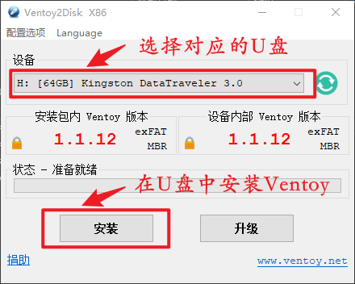
</p>

c）安装完成后，直接将系统镜像文件拷贝到U盘中，等待10分钟左右。

<p align = "center">
    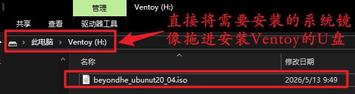
</p>
### 2、磁盘分区

​	在windows下进行磁盘分区，给需要安装的Ubuntu系统分配内存空间。进入磁盘管理界面进行**压缩卷**，为Ubuntu压缩出80-100G的空间，具体操作请自行查找资料进行。在此，我放置一个步骤参考链接[[磁盘分区_哔哩哔哩_bilibili](https://www.bilibili.com/video/BV1554y1n7zv?spm_id_from=333.788.videopod.episodes&vd_source=99b2df0076a6e3cf9f819661e5357db7&p=5)]。

### 3、系统安装

a）重启电脑，进入BIOS后设置选择U盘启动，保存并退出，系统会进入Ventoy引导菜单。不同品牌电脑进入BIOS方式不同，这里就不再说明，请自行查找。

<p align = "center">
    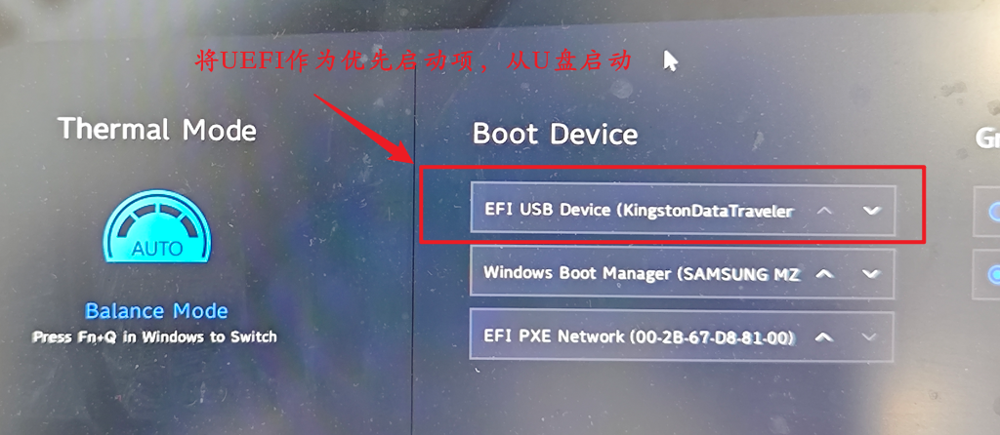
</p>

设置好启动顺序后，系统进入Ventoy引导菜单，如下图所示。通过上下键选择需要安装的系统镜像后，回车确认。

<p align = "center">
    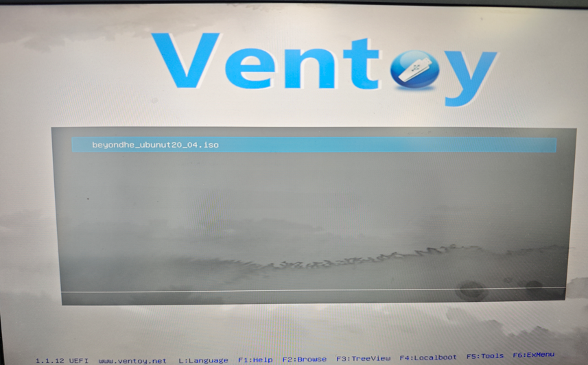
</p>

**注：**如果你在安装过程中，遇到以下图片的情况，可能是你系统主板安全验证没有关闭，需要进行关闭后才能正常进入Ventoy引导菜单。

<p align = "center">
    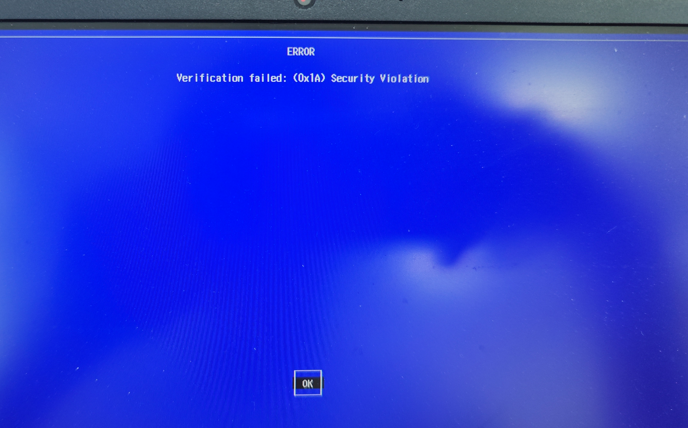
</p>

b）在Ventoy中选择系统引导模式。选择正常引导模式和grub2引导模式都可以，我这里选择grub2引导模式。通过上下方向键进行选择，回车进行确认后，进入Systemback界面。

<p align = "center">
    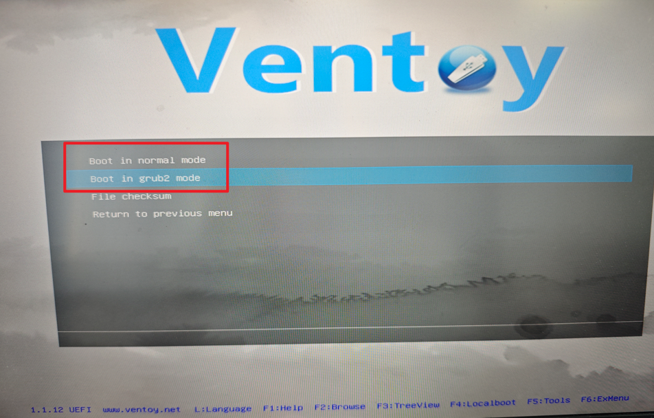
</p>

c）在Systemback界面中，选择第二个选项**启动系统安装器**（Boot system installer），回车进入系统加载界面。Systemback是系统镜像制作软件，beyondhe_ubunut20_04.iso就是通过它进行制作的。

<p align = "center">
    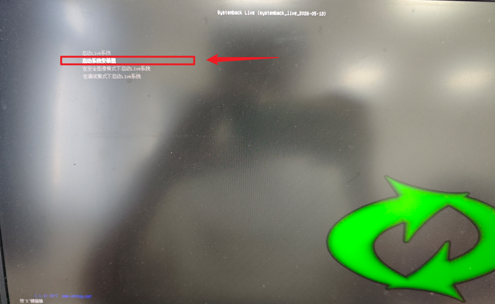
</p>

等待几分钟，加载完毕后系统进入登录界面。

<p align = "center">
    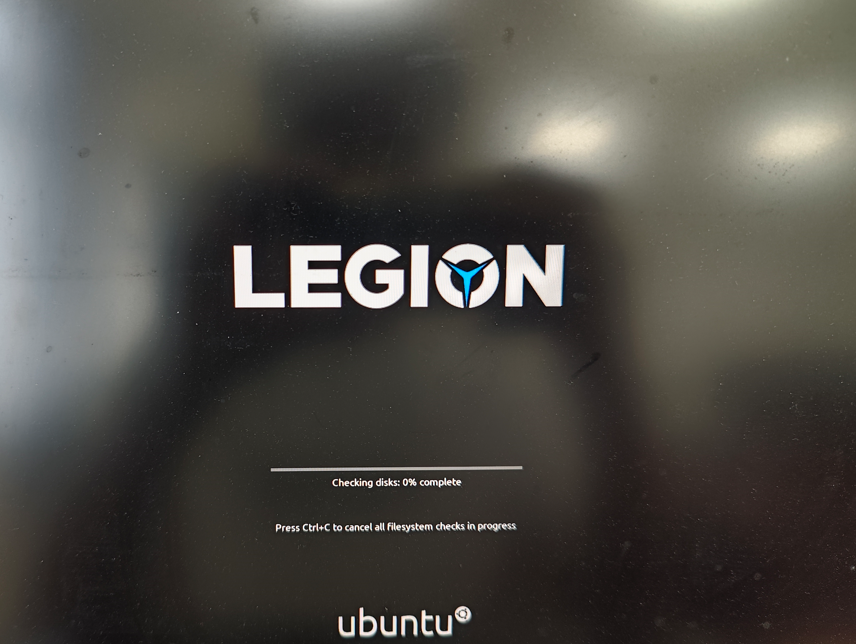
</p>

在系统登录界面，输入密码进入系统安装界面。**该镜像密码为：beyond**

<p align = "center">
    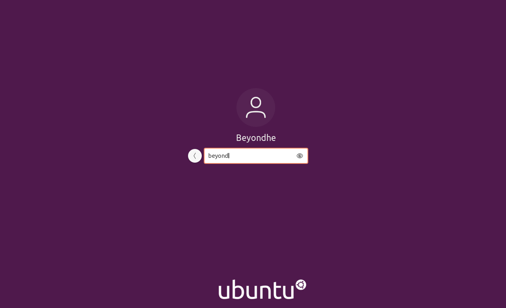
</p>

d）设置系统账号密码。**用户名与密码不建议进行更改**，因为用户名对不上时，系统依赖会出现找不到路径的情况。在设置时最好与下方图片设置完全一致，点击下一步。

<p align = "center">
    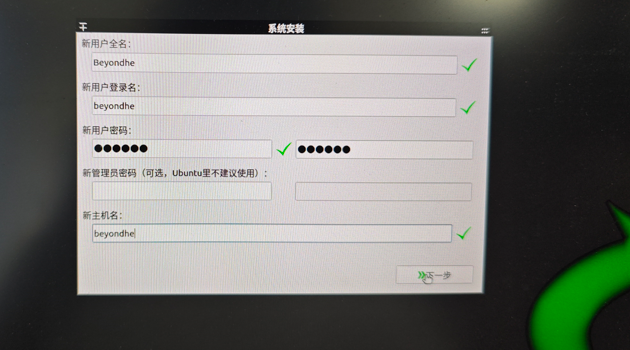
</p>

e）进入系统分区设置。分别设置4个分区：/boot/efi、SWAP、/、/home。内存按需进行分配，/home类似windows下的D盘建议分配空间大一点，/类似windows下的C盘。

<p align = "center">
    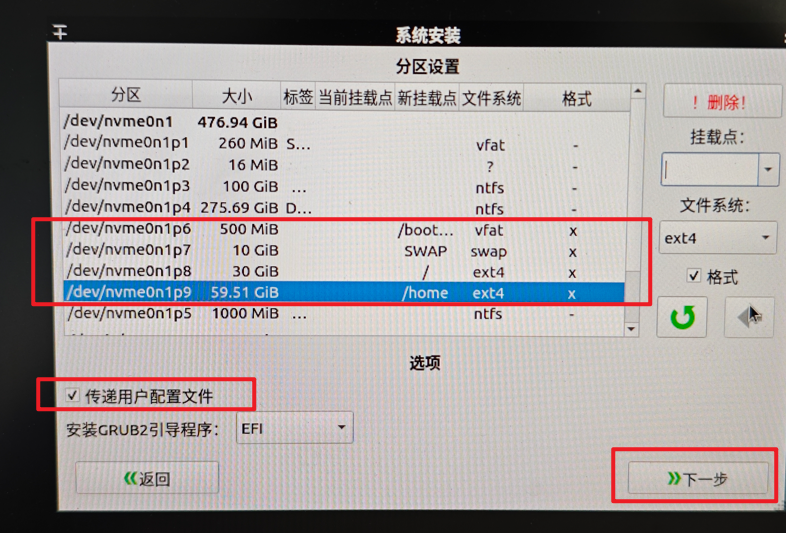
</p>

f）安装系统，并重启。

<p align = "center">
    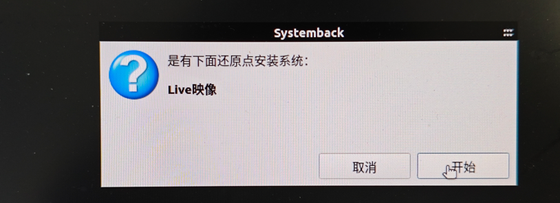
    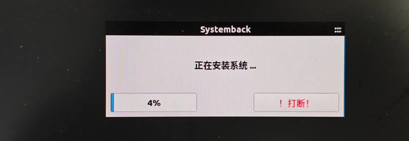
    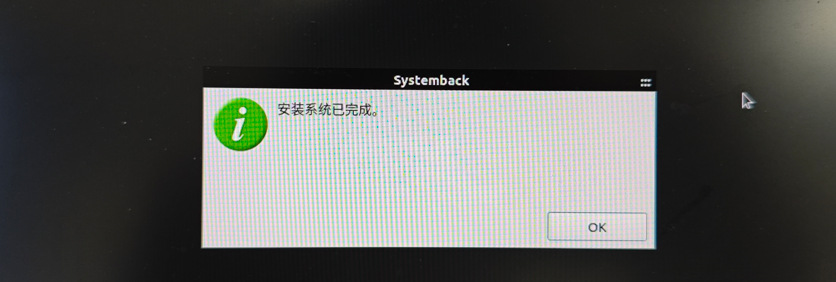
    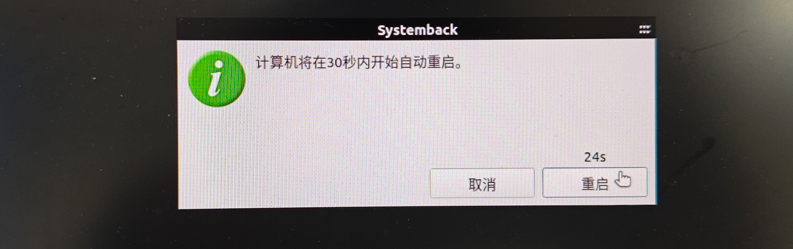
</p>

g）重启后输入密码，进入以下界面，系统安装完成。

<p align = "center">
    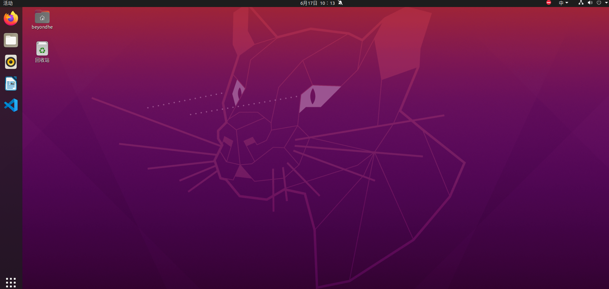
</p>

### 4、测试例程

为了验证系统是否正确安装，启动我预先部署在该镜像的程序。打开两个终端窗口，分别输入以下两条指令，启动gazebo仿真环境并运行算法：

```shell
# 启动多机仿真环境
roslaunch px4 multi_uav_mavros_sitl.launch 
# 启动编写好的避障算法
rosrun swarm_control_pkg swarm_vasarhelyi_control
```

成功启动说明系统安装没有问题，以下是例程运行效果：

<p align = "center">
    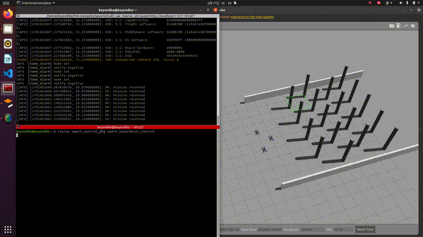
</p>


