## 远程连接树莓派

**设备**：树莓派4B、windows电脑

远程连接软件：MobaXterm

**注：树莓派的默认密码为raspberry，SSH远程连接或者启动管理员模式时需要使用。VNC连接密码设置为123456**。**TP-LINK_Swarm连接密码为beyondhe，管理员密码也为beyondhe。**

### 1、网络连接

a）两个设备同时连接TP-LINK_Swarm这个WIFI网络

<p align = "center">
    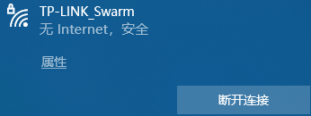
</p>

b）打开终端窗口检查设备的IP地址。

ubuntu下使用：

```shell
ifconfig
```

<p align = "center">
    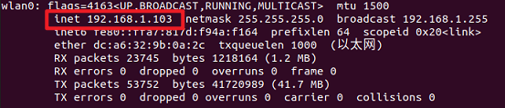
</p>

windows下使用：

```shell
ipconfig
```

<p align = "center">
    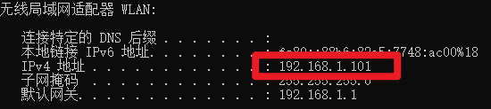
</p>

c）IP与MAC绑定设置

使用windows在浏览器输入网关地址192.168.1.1进入路由器管理页面。绑定设备的IP并进行命名。

<p align = "center">
    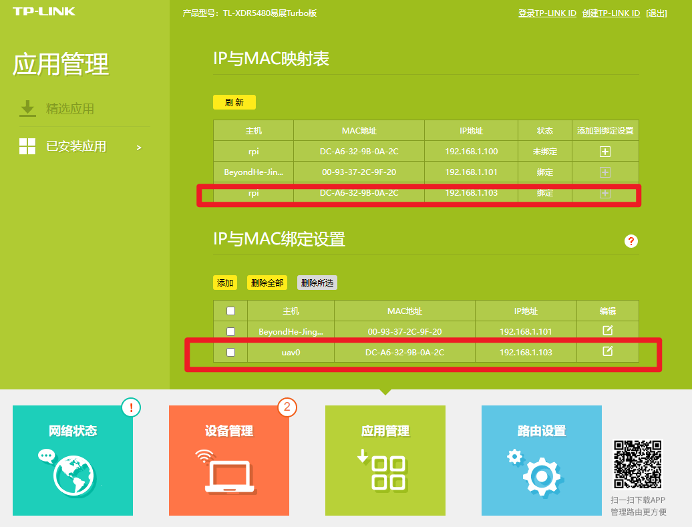
</p>

### 2、SSH远程连接

**树莓派的默认密码为：raspberry**

在此之前，请确认设备在同一局域网，且请严格按照以下步骤进行操作。

<p align = "center">
    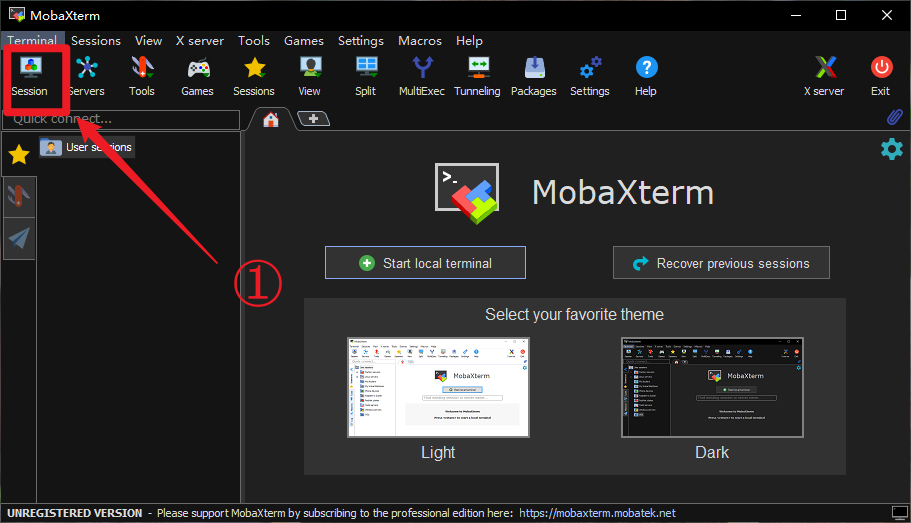
</p>

<p align = "center">
    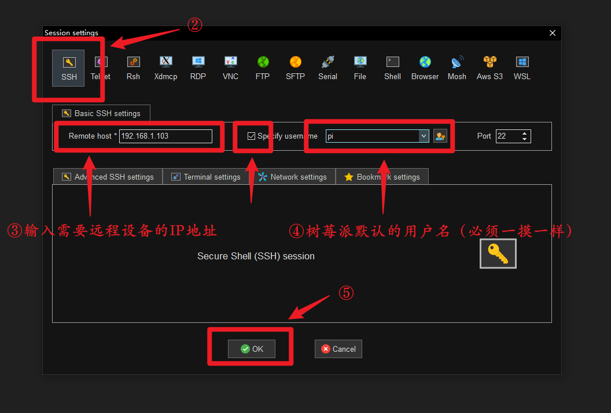
</p>

<p align = "center">
    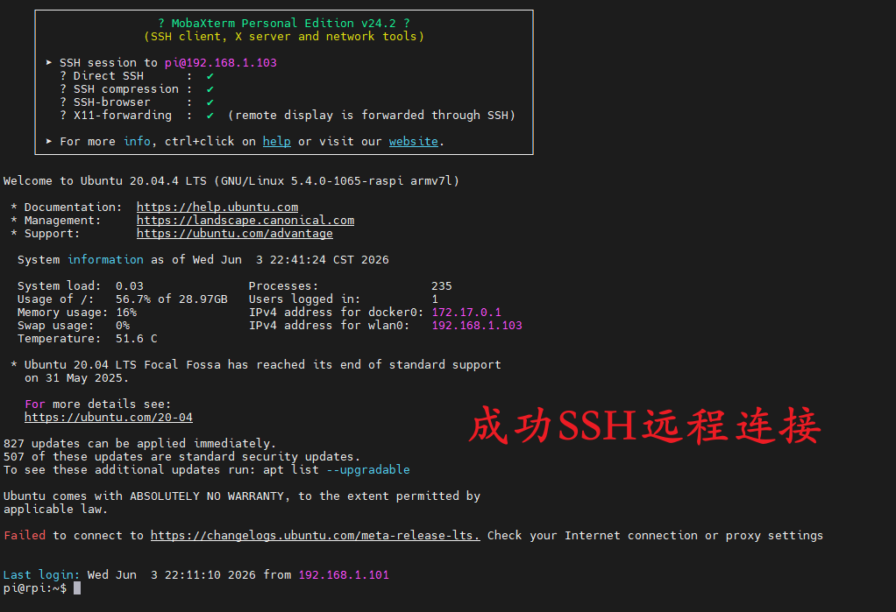
</p>

### 3、VNC远程连接

**树莓派的VNC密码为：123456**

a）打开Ubuntu的设置(Settings)下的Sharing选项，并按照以下步骤进行。

<p align = "center">
    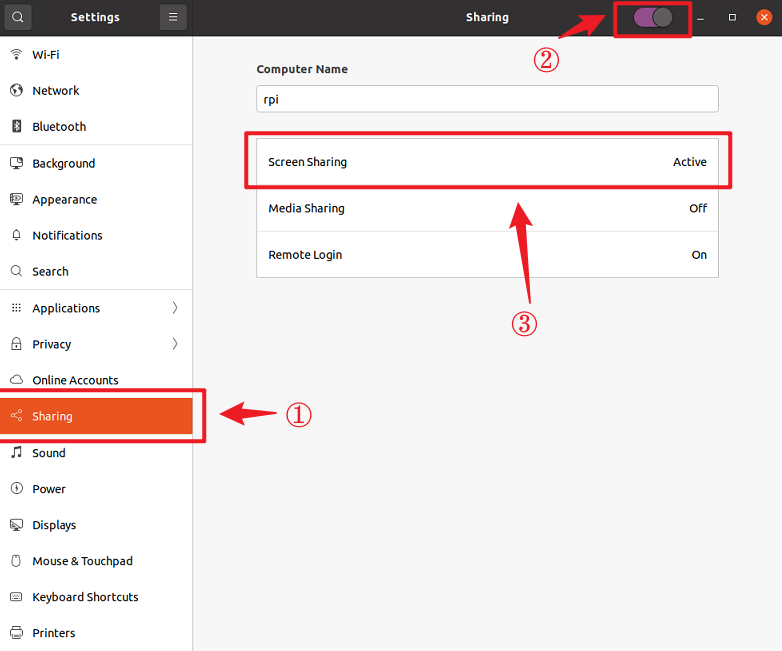
</p>

<p align = "center">
    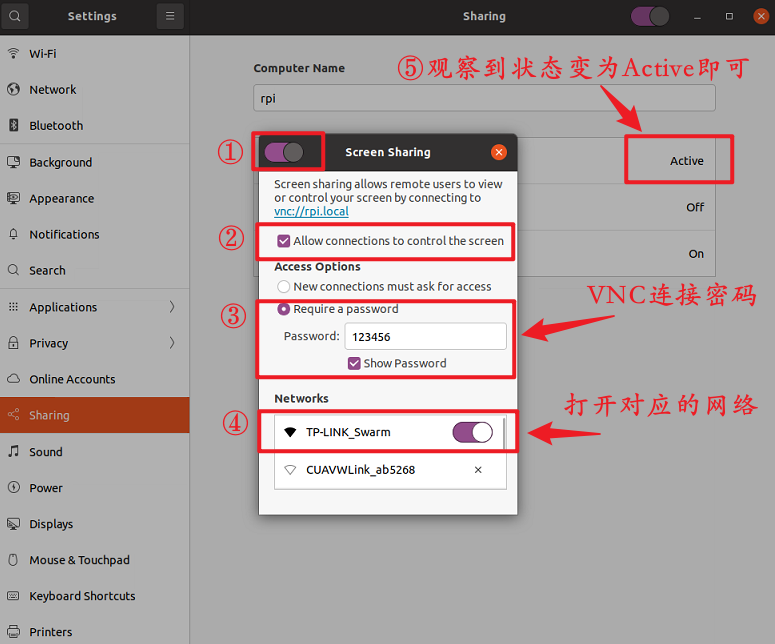
</p>

b）在windows下进行远程VNC连接

<p align = "center">
    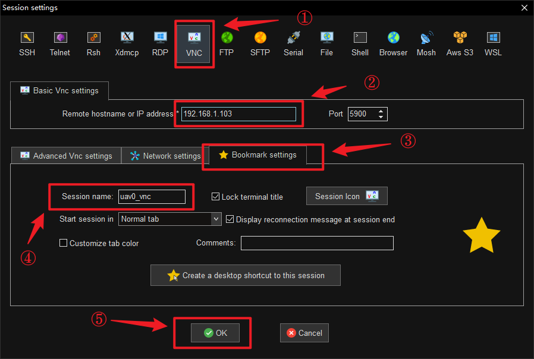
</p>

<p align = "center">
    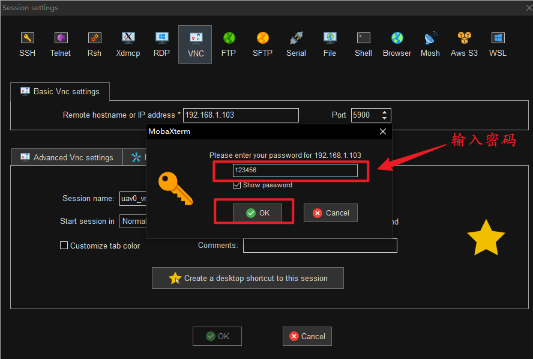
</p>

<p align = "center">
    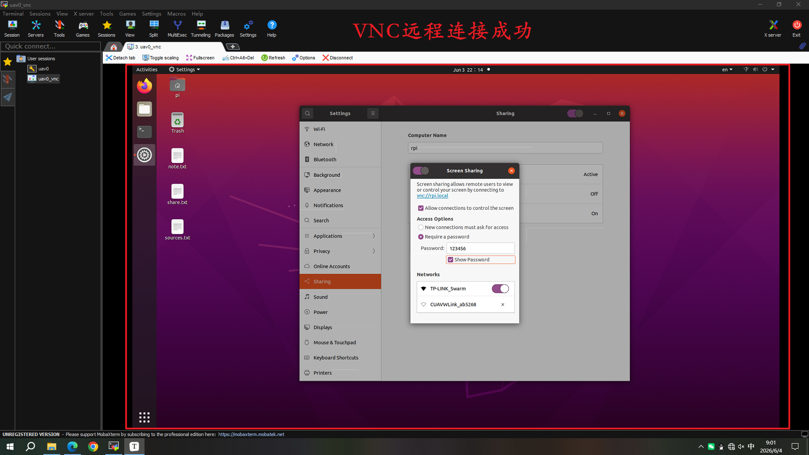
</p>

